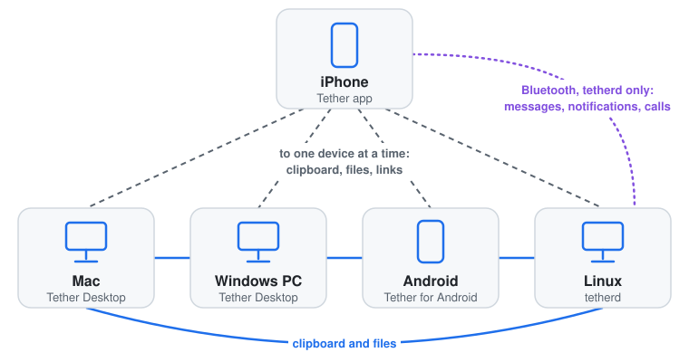
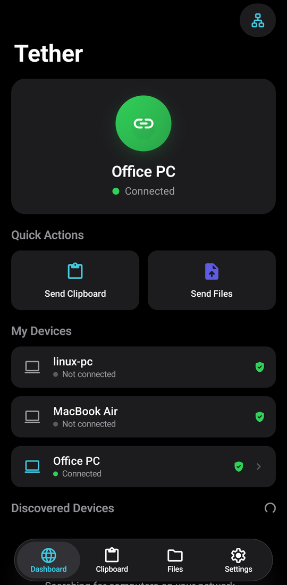

# Tether for Android


An Android peer for [Tether](https://github.com/zackb/tether). The iPhone app, [Tether Desktop](https://github.com/freeyoung/tether-desktop) on macOS and Windows, and `tetherd` on Linux see the phone as one more computer, and paired devices share the clipboard and files with each other: copy on the Mac, paste on the phone.

The project brings Android into the set of Tether Desktop: all the devices at hand share the clipboard and send files to each other, the phone too.



Tether for Android is not an official app of Tether, and the authors of Tether do not make it. It has the features of Tether Desktop and no more: the clipboard and files, over Wi-Fi. Messages, notifications and calls are between the iPhone and `tetherd`.

## Features

- Pairs with the iPhone app and with computers. You approve each pairing.
- Syncs clipboard text and images. Android limits what an app in the background can read, see [The clipboard on Android](#the-clipboard-on-android).
- Keeps a history of the clipboard. Tap an entry to copy it again.
- Receives files into Downloads. Sends files and photos from the app or from the share sheet.
- Opens links that the iPhone shares: at once while Tether is on the screen, else from a notification.

The screens follow the iPhone app: Dashboard, Clipboard, Files and Settings.



## The clipboard on Android

Clips from other devices go to the phone's clipboard at once, and Android shows its preview for each one. Settings > Sync > Write to the Clipboard turns this off: clips then go to the history only.

Android lets an app read the clipboard only while the app is on the screen. So Tether sends what you copied on the phone when you open Tether, when you tap Send Clipboard in Quick Settings or in the notification, and when you share text to Tether.

### Automatic sending (experimental)

Settings > Experimental > Send Automatically also sends what you copy in other apps. Android tells a background app nothing when the clipboard changes, but it logs that it denied the app the change. Tether reads the log for that line, takes the focus for a moment, and reads the clipboard. KDE Connect does the same.

It needs two permissions. Display over other apps is in Android's settings, and Settings in the app opens the page. Log access only adb can grant:

```bash
adb shell pm grant io.github.freeyoung.tether android.permission.READ_LOGS
adb shell am force-stop io.github.freeyoung.tether
```

The costs:

- Android 13 and later ask for log access each time Tether starts, for example after a reboot or an update, and ask only while Tether is on the screen. So open Tether once after each restart. Settings shows when access is missing.
- For each read, Android shows "Tether pasted from your clipboard". To hide it, turn off "Show clipboard access" in Android's privacy settings. Then no app's reads show the message.
- With log access, Tether could read the logs of all apps. It reads only the lines of the clipboard service.

## Install

Download the APK from [Releases](../../releases) and open it on the phone. Android 10 or later.

The APK is not from Google Play, so Android asks you to allow installs from the browser or the file manager. Each release is signed with the same key of this project, so an update installs over the app. A build of your own has another key: uninstall it before you install a release.

## Setup

On the first start, allow notifications. Some phones stop apps in the background to save battery: if Dashboard shows a card for this, tap it.

To pair the iPhone, open Tether on it and tap the phone. Then tap Accept on the phone, or Allow in the notification while Tether is in the background. The iPhone keeps one connection at a time.

To pair a computer, choose it in Discovered Devices, then approve it on the computer. For `tetherd`, run `tether accept <fingerprint>`; Settings shows this phone's fingerprint. If the computer is not in the list, for example over Tailscale, tap the network button at the top of Dashboard. A computer can also ask to pair, as with any other computer.

Paired devices reconnect by themselves. Tether shows a notification while it runs; Stop in the notification, or Run Tether in Settings, turns it off.

## Files and logs

- Settings: the app's private storage.
- Log: `adb logcat -s Tether TetherCore`

Received files go to Downloads.

## Security

- A device can only ask to pair until you approve it. Paired devices are pinned by the SHA-256 of their certificate.
- The private key is in the app's private storage, which only the app can read.
- Logs never hold clipboard or file content, and content that Android marks as sensitive, such as a password, is not synced.
- A received file keeps only its plain name, and goes to Downloads only when it is complete. Limits: 4 GiB for a file, 32 MiB for a clipboard image.
- Only http and https links open.

## Development

The engine is [tether-core-go](https://github.com/freeyoung/tether-core-go), which Tether Desktop uses too, so that one engine serves every platform. The app around it is in Kotlin with Jetpack Compose.

- `go`: `libtether.so`, the engine with a JSON interface for the app. `bridge.go` has no cgo, so its tests run on any OS; `export_android.go` and `jni_android.c` are the JNI layer.
- `app`: the app. `TetherService` runs the engine, `Discovery` publishes and finds `_tether._tcp` with NsdManager, `ClipboardWatcher` does the automatic sending, and `ui/` holds the screens, after the SwiftUI views of the iPhone app.

[protocol.md](https://github.com/freeyoung/tether-core-go/blob/main/docs/protocol.md) in tether-core-go lists the rules that the engine follows, so that several devices sync without loops.

### Build

```bash
./gradlew assembleDebug   # app/build/outputs/apk/debug/app-debug.apk: Go 1.27, JDK 21, Android SDK 37, NDK 30.0.16248370
```

Put the SDK path in `local.properties` (`sdk.dir=...`) or in `ANDROID_HOME`. Gradle runs `scripts/build-native.sh` first, which builds `libtether.so` for arm64-v8a and x86_64. The engine names its version, the one in `go/go.mod`, in hello: it reads it from the build information.

For a signed release build, put the path of a properties file with `storeFile`, `storePassword`, `keyAlias` and `keyPassword` in the Gradle property `tether.keystore`, in `~/.gradle/gradle.properties`. Then run `./gradlew assembleRelease -Ptether.version=0.1.0`. `app/src/main/res/drawable/ic_launcher_foreground.xml` draws the icon of Tether Desktop as a vector.

### Test

```bash
(cd go && go test -race .)
./gradlew testDebugUnitTest
```

The Go tests run the bridge against a second engine on one machine: pairing, clipboard text and images, and files in both directions. For a test computer, `go run github.com/freeyoung/tether-core-go/cmd/tether-headless@latest` runs the engine without a user interface. On the emulator, `adb forward tcp:15134 tcp:5134` lets it reach the phone at `127.0.0.1:15134`.

### Release

CI tests and builds the app. Push a tag such as `v0.1.0`, and `.github/workflows/release.yml` builds the signed APK and publishes it with SHA256SUMS. It signs with the key in the secrets `ANDROID_KEYSTORE` and `ANDROID_KEYSTORE_PASSWORD`. Keep a copy of this key: without it, a new release cannot install over the old one.

## License

MIT, see [LICENSE](LICENSE). The `sym_*` icons are [Material Symbols](https://github.com/google/material-design-icons), under the Apache License 2.0, see [third_party/material-symbols](third_party/material-symbols).
